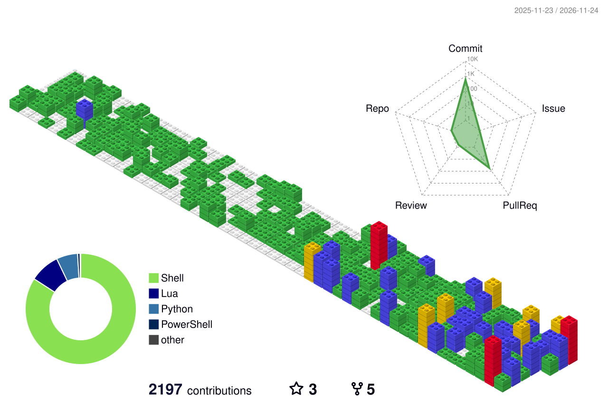

# Hi, I'm Jack

Software engineer in Tokyo, building data products end to end: warehouse pipelines, LLM ingestion for RAG retrieval, and the backend services and infrastructure around them. Before that, full-stack web development and applied computer vision.

- From Taiwan; lived in Sydney for a decade before moving to Tokyo
- B.Eng. in Computer Systems and M.Eng. (research) in computer vision from the [University of Technology Sydney](https://www.uts.edu.au/)

## Tech stack

| Area | Tools |
| --- | --- |
| **Languages** |        |
| **Data engineering** |        |
| **LLM, ML & computer vision** |      |
| **Backend** |      |
| **Frontend** |    |
| **Cloud & infrastructure** |        |
| **Build & tooling** |    |

**Editor & terminal:** Neovim (LazyVim), VS Code, WezTerm, zsh, Nushell and tmux, with dotfiles managed by chezmoi.

## Contributions

<picture>
  <source media="(prefers-color-scheme: dark)" srcset="./profile-3d-contrib/profile-night-green.svg">
  
</picture>
